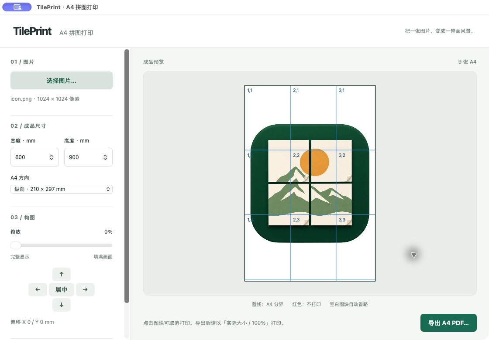

# TilePrint

[English](README.md) | 简体中文

TilePrint 将一张图片拆分为多页无边距 A4 PDF。按 **实际大小 / 100%** 打印，再拼接纸张，即可得到指定物理尺寸的海报。

## 程序截图



macOS 实际运行截图，使用项目自带的 `resources/icon.png` 演示：成品尺寸为 600 × 900 mm，纵向 A4，共打印 9 张。黑框表示成品范围，蓝线表示 A4 分界。

## 桌面界面

从源码运行需要 **Go 1.27.3 或更新版本**，Go 可自动下载所需工具链。桌面界面使用 [MyGo](https://github.com/egoist/mygo) v0.8.3 和系统 WebView：

- macOS：使用系统自带的 WKWebView。
- Windows：需要 WebView2 Runtime。
- Linux：需要 GTK 3 和 WebKitGTK 4.1；Debian/Ubuntu 对应 `libwebkit2gtk-4.1-0`。

不带参数启动桌面界面：

```sh
go run .
```

使用步骤：

1. 点击 **选择图片…**，打开 PNG、JPEG 或 GIF 图片。
2. 输入成品宽度和高度，单位均为毫米，并选择 A4 纵向、横向或自动方向。
3. 使用缩放滑块，在完整显示与填满画面之间调整构图；方向按钮每次移动图片 5 mm，点击 **居中** 重置位置。
4. 点击预览中的 A4 图块可取消或恢复打印；取消的图块显示红色透明遮罩，完全空白的图块自动省略。
5. 按需勾选 **第一页打印拼接地图**，在图块前添加拼接示意图；不打印的图块会在地图上划掉。
6. 点击 **导出 A4 PDF…**，选择保存位置。

预览与 PDF 导出使用相同的图片布局和纸张方向计算。文件选择和保存使用系统原生对话框；导出先写入临时文件，成功后再替换目标文件，失败时保留原文件。

`web/` 中的 HTML、CSS 和 JavaScript 通过 `go:embed` 嵌入可执行文件，无需 Node、Bun、前端构建或本地 HTTP 服务。

## 构建与测试

构建本地可执行文件：

```sh
go build -o build/tileprint .
```

打包 macOS 应用，包含 Finder 图标：

```sh
go run github.com/egoist/mygo/cmd/mygo@v0.8.3 build -skip-dmg
open build/darwin-arm64/TilePrint.app
```

`mygo.json` 定义应用标识和图标；macOS 使用本地临时签名（ad-hoc）。应用图标位于 `resources/icon.png`，生成图标的提示词位于 `resources/icon-prompt.txt`。

运行回归测试：

```sh
go test ./...
```

## 命令行快速开始

指定 `-in` 后进入命令行模式：

```sh
go run . \
  -in artwork.png \
  -out poster.pdf \
  -width 900 \
  -height 600
```

此命令生成成品尺寸为 900 × 600 mm 的海报 PDF。

### 参数

| 参数 | 说明 |
| --- | --- |
| `-in` | 输入 PNG、JPEG 或 GIF 图片路径，命令行模式必填 |
| `-out` | 输出 PDF 路径，默认 `poster.pdf` |
| `-width` | 成品宽度，单位 mm，必填 |
| `-height` | 成品高度，单位 mm，必填 |
| `-fit` | 图片适配方式：`contain`（默认）、`cover` 或 `stretch` |
| `-zoom` | 从完整显示（0）到填满画面（1）的连续缩放，覆盖 `-fit` |
| `-offset-x` | 图片水平偏移，单位 mm，默认 0 |
| `-offset-y` | 图片垂直偏移，单位 mm，默认 0 |
| `-map` | 在第一页添加拼接地图 |
| `-gui` | 打开桌面界面 |
| `-orientation` | A4 方向：`portrait`（默认）、`landscape` 或 `auto` |

`contain` 保持图片比例，完整居中显示在成品范围内；空白区域不绘制，完全不含图片的 A4 图块不导出。`cover` 保持比例并填满成品范围，超出部分会被裁切。`stretch` 拉伸图片，不保留原始宽高比。

## 打印注意事项

在打印对话框中关闭“适合页面 / 缩放以适应”，选择 **实际大小 / 100%**。

TilePrint 不额外添加页边距、裁切线或标签，图片直接铺到 A4 纸边缘。打印机需要支持 **A4 无边距打印**；PDF 无法消除打印机硬件本身的不可打印边距。

## 自动构建与发布

`.github/workflows/build.yml` 在各平台的 GitHub 托管运行器上测试并打包 Windows x64、macOS Apple Silicon、macOS Intel 和 Linux x64。

推送到 `main`、提交 Pull Request 或手动运行 **Run workflow**，会在工作流的 **Artifacts** 中上传安装包，保留 14 天，不发布 Release。

推送版本标签会自动发布 GitHub Release：

```sh
git tag v0.1.0
git push origin v0.1.0
```

支持 `vMAJOR.MINOR.PATCH` 和 `v0.2.0-beta.1` 等预发布标签。标签版本只在打包时写入 `mygo.json`，随后恢复受版本控制的文件。预发布标签生成 GitHub 预发布版本。

四个平台全部构建成功后，工作流创建草稿 Release，上传所有包及 `SHA256SUMS.txt`，然后公开发布。上传失败时保留草稿以便重跑；重跑会替换同名资源。

发布产物包括：

- Windows：在线安装包、包含 WebView2 的离线安装包、便携 ZIP。
- macOS：每种架构分别提供 DMG 和包含应用包的 ZIP。
- Linux：tar.gz 和 Debian 安装包；运行桌面界面仍需 GTK 3 和 WebKitGTK 4.1。

仅发布任务使用 GitHub 内置令牌的 `contents: write` 权限，无需个人访问令牌。仓库需启用 GitHub Actions，组织策略需允许相关 Action 和 Release 写入。

尚未配置签名证书：Windows 包未签名；macOS 使用 ad-hoc 签名，未经 Apple 公证。仍需在真实 Windows、macOS 和 Linux 环境验证安装与 GUI 启动。

也可在对应平台的仓库根目录使用 Python 3 运行 `scripts/ci-package.py`，例如：

```sh
python3 scripts/ci-package.py darwin-arm64
```

版本化产物放在 `dist/`。请在干净的检出目录运行，避免混入旧构建产物。

## Windows 分发

初始支持的测试目标为 **Windows 10 22H2 x64 / Windows 11 x64**。用户电脑无需安装 Go 或 Node。

程序在创建 WebView 窗口前检查 WebView2。若缺失，会显示中文原生对话框，提供安装、打开微软下载页或退出选项。下载文件必须通过 Windows Authenticode 验证，且签名者必须为 Microsoft Corporation，才会执行。交互启动安装时显示微软的安装界面。

安装和卸载向导采用简体中文（NSIS SimpChinese），包含标准按钮、目录选择、完成页与桌面快捷方式选项。语言配置位于 `mygo.json` 和 `locales/zh-Hans.json`。

在仓库根目录构建在线安装包：

```sh
go run scripts/package-windows.go
```

构建包含微软完整 x64 Evergreen 安装程序的离线包：

```sh
go run scripts/package-windows.go -offline
# 也可使用已经下载的微软官方 x64 安装程序：
go run scripts/package-windows.go -runtime-installer /path/to/MicrosoftEdgeWebView2RuntimeInstallerX64.exe
```

产物分别位于 `build/windows-online/windows-amd64/` 和 `build/windows-offline/windows-amd64/`，分发其中的 `tileprint-setup-*.exe`。

在线安装包仅在缺少 WebView2 时下载运行时；离线安装包解压并运行内置安装程序，无需联网。两者均等待安装完成，再次检查依赖；失败时显示“重试 / 取消”。静默安装（`/S`）无法安装依赖时以退出码 1 失败。默认按当前用户安装。

MyGo CLI 在 Windows 上会自动下载 NSIS；从 macOS 制作安装包需要先安装 NSIS（`brew install nsis`）。离线包仅在构建机器上下载完整运行时。

签名验证使用 Windows PowerShell 和本地 Windows 信任存储；企业策略限制或证书信任不可用会导致明确报错，不会跳过验证。

Windows 启动诊断追加写入 `%LOCALAPPDATA%\TilePrint\logs\startup.log`。GUI 加载失败会显示原生中文错误提示，PDF 导出失败会在界面显示。

构建无安装向导的便携程序：

```sh
go run github.com/egoist/mygo/cmd/mygo@v0.8.3 build -platform windows/amd64 -skip-installer
```

便携程序在缺少 WebView2 时提供在线安装；全新电脑完全离线使用时应选择离线安装包。除非在 `mygo.json` 的 `windows` 下配置证书或签名命令，Windows 安装包均未签名。SmartScreen 信誉与运行时安装是独立问题，请勿通过关闭 SmartScreen 或杀毒软件绕过提示。

Windows 发布前需在真实机器或虚拟机验证：

- 无 WebView2 的全新 Windows 10 22H2 x64：在线安装并启动。
- 全新断网环境：离线安装，以及失败后的重试 / 取消。
- 已安装 WebView2：跳过依赖安装，以普通用户正常运行。
- 便携版原生启动提示、网络失败和日志。
- 含中文或空格的图片及输出路径，已有或正在打开的 PDF 目标文件。
- 100%、150%、200% DPI 下的预览选择、拼接地图及 PDF 页数。

## 代码结构

- `main.go`：命令行入口。
- `poster.go`：布局与 PDF 引擎。
- `service.go`：预览和导出共用的服务。
- `gui.go`：MyGo 桌面集成。
- `web/`：嵌入式前端界面。

布局最多允许 10,000 个网格单元，以保持预览和导出的响应速度。
